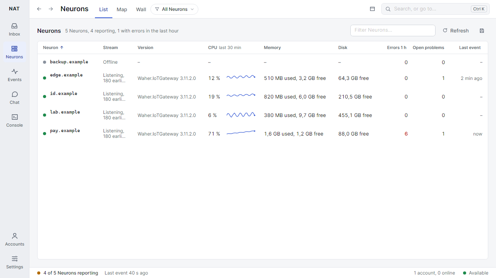

# NAT

**One app to watch and run your Neurons.**

<picture>
  <source media="(prefers-color-scheme: dark)" srcset="docs/images/neurons-dark.png">
  
</picture>

## What you can do

| Place | What it is for |
|:------|:---------------|
| Inbox | What needs you: messages, requests, and notices from your Neurons |
| Neurons | Every Neuron at a glance, with a page each for software, sources, traffic and more |
| Events | Events from all your Neurons as they happen, grouped into problems |
| Chat | Your coworkers and rooms, end-to-end encrypted where both sides can |
| Console | Commands on one Neuron or many at once, answers side by side |

## Install

1. Download `Neuro.Nat-win-Setup.exe` from the [latest release](https://github.com/berggrenmille/Neuro-AA/releases/latest).
2. Run it. It installs for you only and needs no admin rights.
3. Add your account on a Neuron, and NAT finds the Neurons in your contacts.

The installer is not signed yet, so Windows warns the first time. Choose "More info", then "Run anyway".
NAT updates itself after that.

## What you need

- Windows 10 or 11.
- An account on a Neuron.
- Admin rights on a Neuron to see its events and run commands there: be its notification address,
  or have the Admin privilege.

## Read more

| Page | What's inside |
|:-----|:--------------|
| [Developing](docs/DEVELOPING.md) | Build from source, run the tests, the local test Neuron |
| [Releasing](docs/RELEASING.md) | Make a release, where updates come from, renaming the repository |
| [Design](DESIGN.md) | How NAT looks and words things |
| [Product](PRODUCT.md) | Who NAT is for and what was decided |
| [Where your data is kept](docs/DATA.md) | The encrypted store, what stays outside it, and moving from older versions |
| [History](docs/history/PLAN-2026-11.md) | The plan of the first version |
